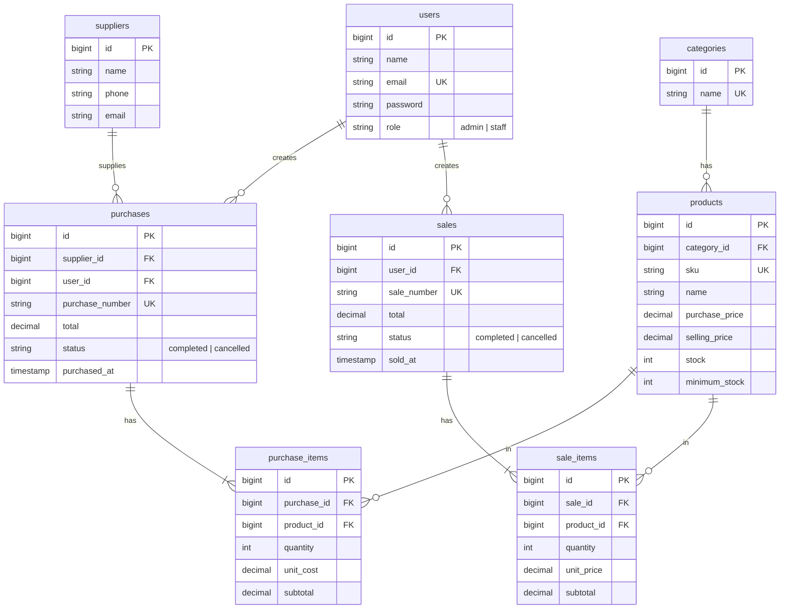
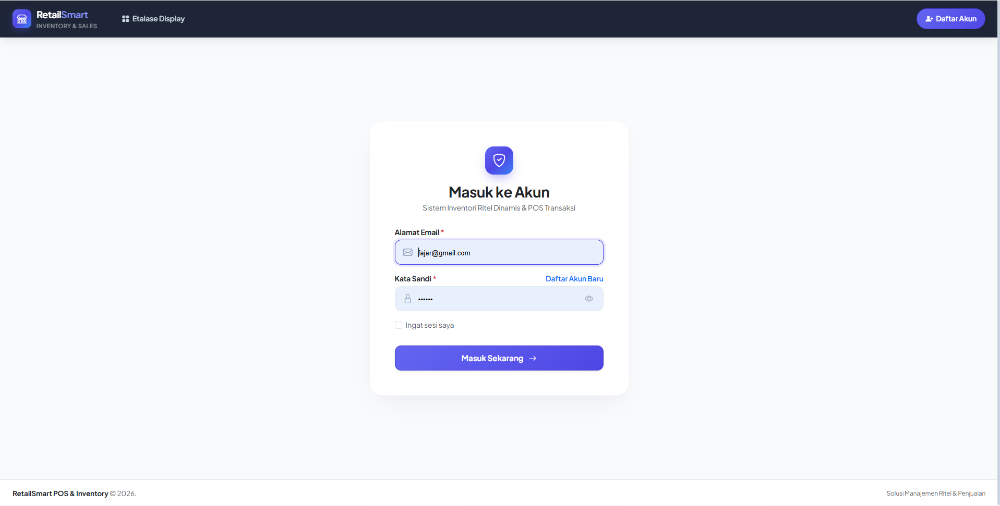
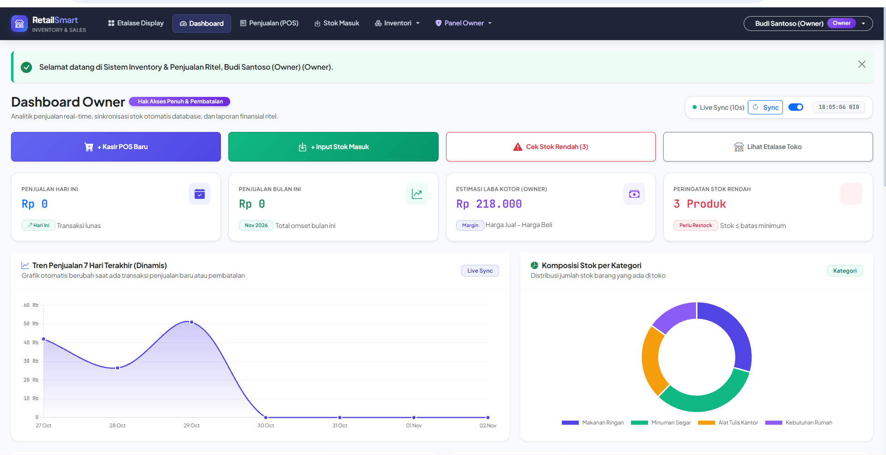
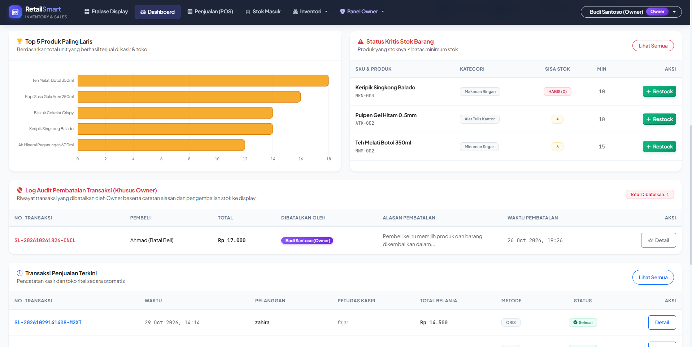
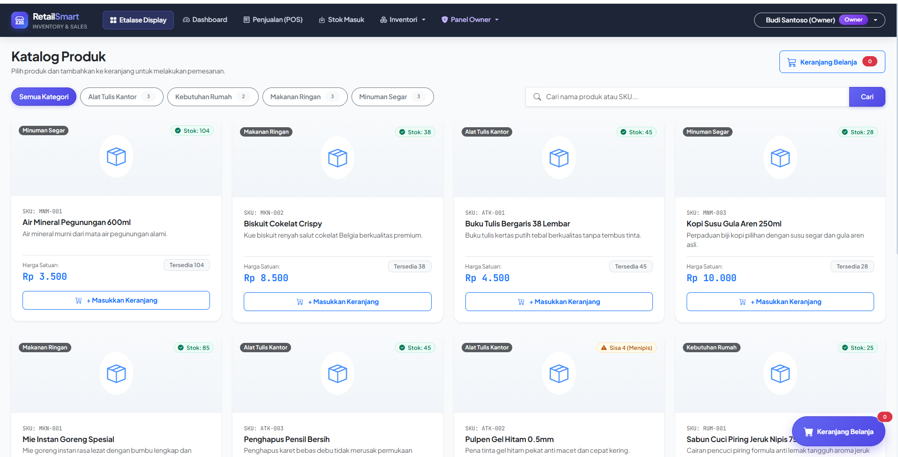
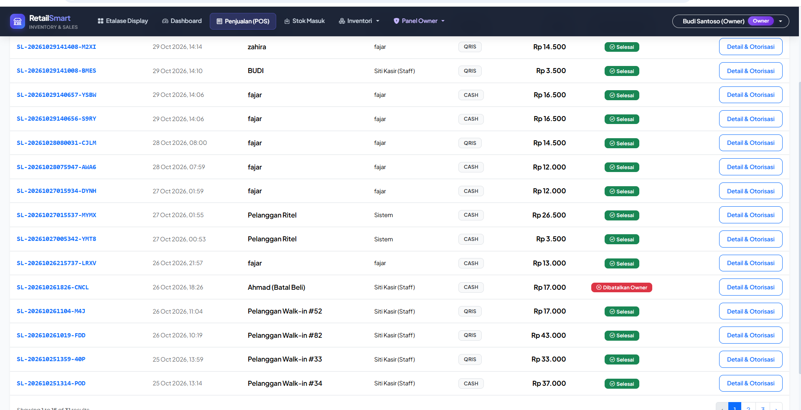
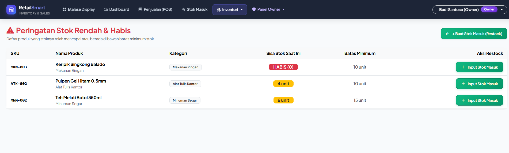
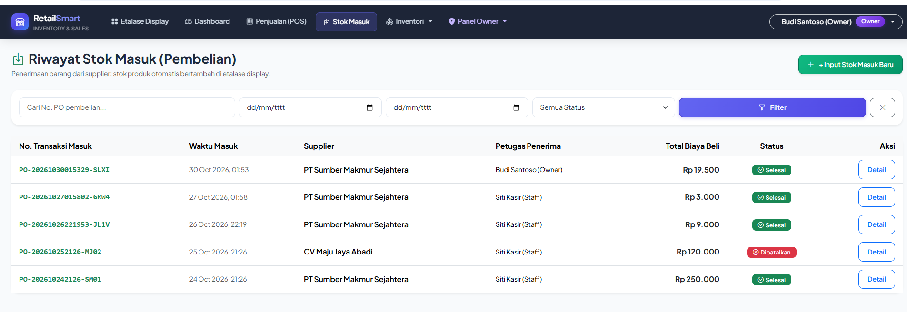

# Inventory & Sales Management System (UTS Web Programming 2)

Aplikasi Laravel sederhana: master data (kategori, produk, supplier), pembelian (stock-in),
penjualan (stock-out), dashboard, role Admin/Staff. Tampilan memakai Bootstrap 5 (CDN).

## 1. Project overview
Stok berubah otomatis saat pembelian/penjualan berhasil. Penjualan dengan stok kurang ditolak.
Semua simpan transaksi memakai `DB::transaction` + `lockForUpdate`.

## 2. Requirements
PHP 8.2+, Composer, MySQL, Laravel 11 atau 12 (aplikasi ini hanya berisi file tambahan di atas project Laravel baru).

## 3. Installation
```bash
composer create-project laravel/laravel inventory-sales
cd inventory-sales
# salin isi folder ini (app, database, resources, routes, tests) ke dalam project, timpa jika ditanya
```

## 4. Environment setup
```bash
cp .env.example .env        # (sudah ada jika memakai create-project)
php artisan key:generate
```
Edit `.env`:
```
DB_CONNECTION=mysql
DB_DATABASE=inventory_sales
DB_USERNAME=root
DB_PASSWORD=
```
Buat database kosong `inventory_sales` di MySQL.

## 5. Migration & seeding
```bash
php artisan migrate --seed
php artisan serve
```
Buka http://127.0.0.1:8000

## 6. Demo account
| Role  | Email             | Password |
|-------|-------------------|----------|
| Admin | admin@example.com | password |
| Staff | staff@example.com | password |

## 7. Features
- Login/logout, password di-hash, route diproteksi `auth`
- Role: Admin (semua fitur), Staff (lihat produk, buat pembelian & penjualan). Dijaga di server dengan Gate `admin` + middleware `can:admin`
- CRUD kategori, produk, supplier (validasi, SKU unik, larangan hapus data yang sudah dipakai)
- Pembelian & penjualan multi-item, total dihitung server, harga jual diambil dari database
- Pembatalan transaksi (Admin) yang memulihkan stok secara konsisten
- Dashboard (total produk, penjualan hari/bulan ini, jumlah transaksi, stok rendah) dari query agregat
- Search SKU/nama, filter kategori/tanggal/status, pagination yang mempertahankan filter
- CSRF, escaping Blade, kredensial hanya di `.env`

## 8. Known limitations
- Tidak ada payment gateway, multi-gudang, atau laporan ekspor
- Edit/hapus pengguna belum ada (hanya daftar & tambah)
- Pembatalan pembelian ditolak jika stok sudah terpakai (agar stok tidak negatif)

## Testing
Test memakai SQLite in-memory bawaan Laravel 11/12:
```bash
php artisan test
```
Skenario: guest ditolak, password salah, SKU duplikat/harga negatif, pembelian menambah stok,
penjualan mengurangi stok, stok tidak cukup, rollback atomik, authorization Staff, pembatalan, search & pagination.

## ERD
Diagram di bawah dirender otomatis oleh GitHub (Mermaid). Salinan gambar: [`docs/erd.png`](docs/erd.png), sumber: [`docs/erd.mmd`](docs/erd.mmd).




### Penjelasan relasi
| Relasi | Tipe Eloquent | Keterangan |
|--------|---------------|------------|
| categories → products | `Category hasMany Product` / `Product belongsTo Category` | `products.category_id` (restrictOnDelete) |
| suppliers → purchases | `Supplier hasMany Purchase` / `Purchase belongsTo Supplier` | `purchases.supplier_id` |
| users → purchases | `User hasMany Purchase` | `purchases.user_id` (petugas penerima) |
| users → sales | `User hasMany Sale` | `sales.user_id` (kasir) |
| purchases → purchase_items | `Purchase hasMany PurchaseItem` | `purchase_items.purchase_id` (cascadeOnDelete) |
| sales → sale_items | `Sale hasMany SaleItem` | `sale_items.sale_id` (cascadeOnDelete) |
| products → purchase_items / sale_items | `Product hasMany ...` | `product_id` (restrictOnDelete, produk yang sudah dipakai tidak bisa dihapus) |

`hasMany` ada di sisi "satu" (mis. Sale hasMany SaleItem); `belongsTo` di sisi "banyak". Foreign key
berada di tabel detail karena satu baris detail hanya milik satu header, sedangkan satu header punya banyak detail.

## Screenshots
Tampilan aplikasi (folder [`docs/screenshots`](docs/screenshots)).

### Login


### Dashboard
Ringkasan penjualan hari/bulan ini, estimasi laba kotor, peringatan stok rendah, tren penjualan 7 hari, dan komposisi stok per kategori.



Top 5 produk terlaris, status kritis stok, log audit pembatalan transaksi, dan transaksi penjualan terkini.



### Etalase / Katalog Produk
Filter kategori, pencarian nama/SKU, dan keranjang belanja.



### Penjualan (POS)
Daftar transaksi dengan metode bayar (CASH/QRIS), status, pagination, dan tombol detail & otorisasi.



### Peringatan Stok Rendah & Habis


### Riwayat Stok Masuk (Pembelian)
Filter nomor PO, tanggal, dan status.


